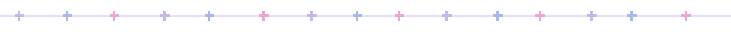

<!-- Self-typing text -->
  
</a>

### about me

> **Electronic engineering @ [Universidad del Norte](https://www.uninorte.edu.co/)** (2024–2029), based in Barranquilla, Colombia.
>
> I lead tech projects and organize **STEM** initiatives: **NASA Space Apps**, **Hack Club Alumni**, **Girls in Quantum** and the **Coloquios de Ciencias**.
>
> I love building, teaching, and bringing curious people together around science and technology.
>
> currently exploring: Cybersecurity

### find me

### stack

### stats

### contributions

<!-- Generated by the snake.yml workflow -->

